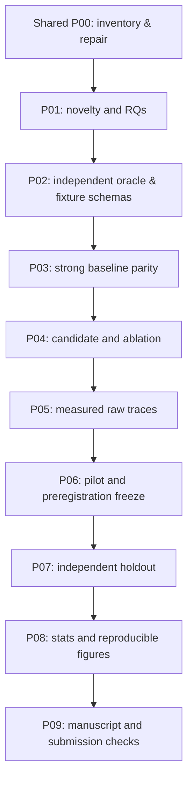

# Dependency and phase navigator

**Task count:** 322. No task has been executed. Dependencies are in `MANIFESTS/tasks.json`; this is an at-a-glance schematic, not a claim of deadline feasibility.

| Stream | P00 | P01 | P02 | P03 | P04 | P05 | P06 | P07 | P08 | P09 | Total |
|---|---:|---:|---:|---:|---:|---:|---:|---:|---:|---:|---:|
| shared | 7 | 4 | 4 | 2 | 1 | 2 | 2 | 0 | 2 | 1 | 25 |
| compsac | 0 | 5 | 5 | 5 | 4 | 4 | 3 | 1 | 4 | 2 | 33 |
| popets | 0 | 5 | 5 | 4 | 5 | 4 | 2 | 2 | 4 | 2 | 33 |
| aime | 0 | 5 | 6 | 4 | 4 | 4 | 2 | 1 | 4 | 3 | 33 |
| ifip_sec | 0 | 5 | 5 | 4 | 5 | 5 | 2 | 1 | 4 | 2 | 33 |
| sacmat | 0 | 5 | 5 | 5 | 4 | 5 | 2 | 1 | 4 | 2 | 33 |
| acns | 0 | 6 | 5 | 2 | 5 | 5 | 2 | 1 | 5 | 2 | 33 |
| dsn | 0 | 5 | 5 | 4 | 4 | 5 | 3 | 1 | 4 | 2 | 33 |
| dimva | 0 | 5 | 7 | 3 | 4 | 4 | 3 | 1 | 4 | 2 | 33 |
| pst | 0 | 5 | 5 | 4 | 4 | 5 | 3 | 1 | 4 | 2 | 33 |

**Note:** individual task graph is more precise than phase skeleton: some P02/P03 tasks can run concurrently; prerequisites must be enforced by taskctl.
