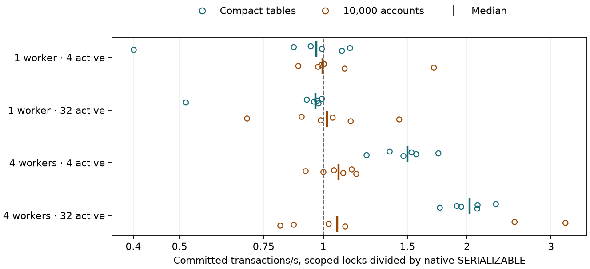

# External procedure development results

On three BenchBase SmallBank procedures executed on PostgreSQL 16.4, the
observed four-worker throughput gap was smaller with larger physical tables.
With 32 active accounts the median paired scoped-locking/native-SERIALIZABLE
ratio fell from 2.024 to 1.069. With four active accounts it fell from 1.501 to
1.077. The padded grid had three scoped-locking losses in twelve four-worker
pairs. At one worker the medians ranged from 0.964 to 1.017.

The 96 campaigns submitted 23,040 operations. An offline checker found at least
one legal serial order in all 5,760 four-operation waves, respecting observed
reads, decisions, real-time precedence and database readback. Both check-debit
branches occurred in both grids. All dormant balances matched at final readback.
This is an observation about these bounded histories. The manually scoped RC arm
uses known dependencies. Neither arm infers a clinical dependency.

## Paired results

Each cell compares committed money-changing operations per second within the
same seed. Every wave runs to completion, including any retries.
“Losses” counts ratios below one before rounding.



| Loaded | Active | Workers | Seed 0 | 1 | 2 | 3 | 4 | 5 | Median ratio | Losses / 6 |
| --- | ---: | ---: | ---: | ---: | ---: | ---: | ---: | ---: | ---: | ---: |
| Compact | 4 | 1 | 0.941 | 0.867 | 1.138 | 0.993 | 0.401 | 1.094 | 0.967 | 4 |
| Compact | 4 | 4 | 1.378 | 1.531 | 1.743 | 1.566 | 1.233 | 1.472 | 1.501 | 0 |
| Compact | 32 | 1 | 0.993 | 0.924 | 0.971 | 0.956 | 0.515 | 0.978 | 0.964 | 6 |
| Compact | 32 | 4 | 2.300 | 2.105 | 1.906 | 1.946 | 1.755 | 2.102 | 2.024 | 0 |
| 10,000 | 4 | 1 | 1.003 | 0.991 | 0.887 | 0.976 | 1.705 | 1.109 | 0.997 | 3 |
| 10,000 | 4 | 4 | 1.147 | 1.053 | 0.919 | 1.001 | 1.101 | 1.173 | 1.077 | 1 |
| 10,000 | 32 | 1 | 0.901 | 1.046 | 0.693 | 1.443 | 0.988 | 1.141 | 1.017 | 3 |
| 10,000 | 32 | 4 | 2.517 | 3.216 | 1.026 | 0.867 | 0.813 | 1.112 | 1.069 | 2 |

Each row below covers 1,440 submitted requests. Insufficient funds is a business
outcome. Exhausted means the database rejected all three attempts. SQLSTATE
40001 counts all serialization failures, including final failures. There were
zero deadlocks. The rate column is the median of six campaign rates.

| Loaded | Active | Workers | Arm | Commits/s | Committed | Insufficient | Exhausted | 40001 |
| --- | ---: | ---: | --- | ---: | ---: | ---: | ---: | ---: |
| Compact | 4 | 1 | SSI | 312.2 | 1272 | 168 | 0 | 0 |
| Compact | 4 | 1 | Scoped RC | 310.6 | 1272 | 168 | 0 | 0 |
| Compact | 4 | 4 | SSI | 297.6 | 833 | 164 | 443 | 2003 |
| Compact | 4 | 4 | Scoped RC | 453.1 | 1272 | 168 | 0 | 0 |
| Compact | 32 | 1 | SSI | 340.8 | 1418 | 22 | 0 | 0 |
| Compact | 32 | 1 | Scoped RC | 332.0 | 1418 | 22 | 0 | 0 |
| Compact | 32 | 4 | SSI | 313.1 | 848 | 18 | 574 | 2284 |
| Compact | 32 | 4 | Scoped RC | 632.1 | 1418 | 22 | 0 | 0 |
| 10,000 | 4 | 1 | SSI | 295.7 | 1272 | 168 | 0 | 0 |
| 10,000 | 4 | 1 | Scoped RC | 298.7 | 1272 | 168 | 0 | 0 |
| 10,000 | 4 | 4 | SSI | 415.6 | 1266 | 168 | 6 | 417 |
| 10,000 | 4 | 4 | Scoped RC | 455.1 | 1272 | 168 | 0 | 0 |
| 10,000 | 32 | 1 | SSI | 256.8 | 1418 | 22 | 0 | 0 |
| 10,000 | 32 | 1 | Scoped RC | 257.1 | 1418 | 22 | 0 | 0 |
| 10,000 | 32 | 4 | SSI | 493.1 | 1417 | 21 | 2 | 85 |
| 10,000 | 32 | 4 | Scoped RC | 539.3 | 1418 | 22 | 0 | 0 |

The padded fixture's representative plans used index scans on all three
point reads in all 48 campaigns. The compact grid did not record plans.
The follow-up ran later on the same shared host. Plan changes, row layout,
host scheduling, retry policy and closed waves limit attribution. In particular,
40001 alone does not distinguish a real data conflict from a conservative
SSI abort. The throughput numerator includes the effect of exhausted retries.
Neither grid estimates full BenchBase performance or establishes superiority.

## Reproduction

Use Python 3.12, psycopg 3.3.5, and the pinned Docker image below. The runner
creates and removes a unique schema on a socket-only PostgreSQL 16.4 cluster.
These commands use a disposable instance, no published ports and a private
parent directory for its socket. Run from the repository root.

```bash
bank_dir=$(mktemp -d)
mkdir "$bank_dir/socket"
bank_id=$(docker run -d --network none -v "$bank_dir/socket:/var/run/postgresql" \
  -e POSTGRES_HOST_AUTH_METHOD=trust \
  postgres@sha256:e62fbf9d3e2b49816a32c400ed2dba83e3b361e6833e624024309c35d334b412 \
  -c listen_addresses='')
# Wait for the post-init server before starting the grid.
until docker exec "$bank_id" sh -c 'test "$(cat /proc/1/comm)" = postgres && pg_isready -U postgres'; do sleep 1; done
python -m evaluation.venue2027.compsac.pg_smallbank "$bank_dir/socket" "$bank_dir/compact.json.gz"
python -m evaluation.venue2027.compsac.pg_smallbank --padded "$bank_dir/socket" "$bank_dir/padded.json.gz"
docker stop "$bank_id" && docker rm -v "$bank_id"
python -m evaluation.venue2027.compsac.smallbank_adjudicate "$bank_dir/compact.json.gz"
python -m evaluation.venue2027.compsac.smallbank_adjudicate "$bank_dir/padded.json.gz"
```

The exact compact runner is in commit `9bade229`. The current runner adds
setup plans and dormant-row counts. Both raw files include the runner hash,
server and client details, operations, attempts' SQLSTATEs, wave readbacks
and intervals. Use the offline tests to check both recorded grids and verify
that deliberately corrupted histories fail replay.

[Compact raw histories](../../proof/artifacts/compsac_smallbank_dev.json.gz) ·
[Padded raw histories](../../proof/artifacts/compsac_smallbank_padded_dev.json.gz) ·
[Source and protocol](protocol.md) · [Nearest prior work and claim boundary](prior.md)
